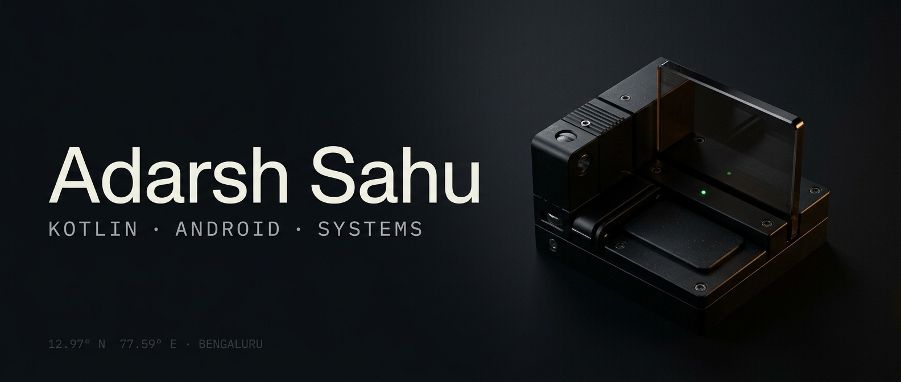

  

 

Building mobile systems in **Kotlin** and **Android** at **[Lenskart](https://www.lenskart.com/)**, Bengaluru.
Outside work, I debug compiler leaks, media pipeline edge cases, and rendering bugs across open source — and build [**wificam**](https://github.com/sahuadarsh0/wificam), a zero-cloud 4K Android-to-PC webcam and studio mic in Rust, WinUI 3, and Jetpack Compose.

  &nbsp;
  &nbsp;
  &nbsp;
  &nbsp;
  

 

## Open Source

  <picture>
    <source media="(prefers-color-scheme: dark)" srcset="./assets/telemetry-dark.svg" />
    <source media="(prefers-color-scheme: light)" srcset="./assets/telemetry-light.svg" />
    
  </picture>

### Recent Contributions

<!-- oss-activity:start -->
- [**MetrolistGroup/Metrolist#5437**](https://github.com/MetrolistGroup/Metrolist/pull/5437) &nbsp;`open`&nbsp; — fix(android): sync YouTube history when loading statistics
- [**chrisbanes/haze#1959**](https://github.com/chrisbanes/haze/pull/1959) &nbsp;`merged`&nbsp; — Preserve Backdrop fallback preparation in merged Glass clusters
- [**chrisbanes/haze#1954**](https://github.com/chrisbanes/haze/pull/1954) &nbsp;`merged`&nbsp; — Skip preparing merged Glass clusters when no source is available
- [**skydoves/landscapist#1053**](https://github.com/skydoves/landscapist/pull/1053) &nbsp;`open`&nbsp; — Avoid replacing app-registered SingletonImageLoader factory in coil3
- [**skydoves/landscapist#1052**](https://github.com/skydoves/landscapist/pull/1052) &nbsp;`open`&nbsp; — Map ContentScale to Coil Scale in coil3 CoilImage
<!-- oss-activity:end -->

 

## Currently Building

- **[wificam](https://github.com/sahuadarsh0/wificam)** — Zero-cloud 4K / 1080p60 Android-to-PC virtual webcam and studio mic (*Rust · WinUI 3 · Media Foundation · Jetpack Compose · H.264 / HEVC / AV1 · RNNoise / AEC3*).
- **Mobile Platform @ [Lenskart](https://www.lenskart.com/)** — Production Android architecture, Compose UI systems, and runtime performance profiling.

 

## Stack

- **Mobile & UI** — Kotlin · Android SDK · Jetpack Compose · Coroutines & Flow
- **Media & Tooling** — AndroidX Media3 / ExoPlayer · Gradle & KSP · Dagger / Hilt · Room
- **Systems & Quality** — Memory & Startup Profiling · Snapshot Testing (Paparazzi) · Rust / JNI

 

---

  

